<p align="center"></p>

# Extrator de Mídias (MediaRescue)

Programa para Windows que **copia os vídeos dos seus CDs e DVDs caseiros** para o computador, um pendrive ou um HD externo — e que **insiste em recuperar o que der** quando o disco está riscado ou envelhecido.

* Funciona **sem instalar nada** e **sem senha de administrador**: é só abrir o `MediaRescue.exe`.
* **Não usa a internet.** Nenhum vídeo, nome ou dado sai do seu computador.
* Confere cada arquivo depois de copiar (compara a cópia com o original) e **nunca apaga nem sobrescreve** nada seu.
* Se um trecho do disco não puder ser lido, o vídeo é salvo mesmo assim (com um pequeno "pulo") e o programa diz exatamente o que faltou.

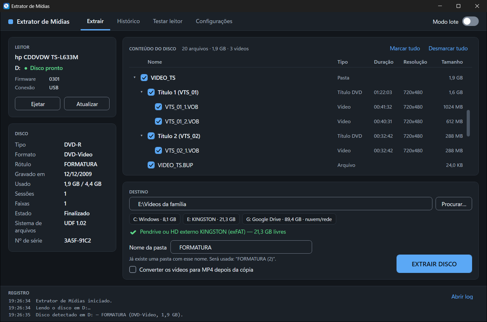

---

## Para quem vai usar (sem termos técnicos)

### O que você precisa

* Windows 10 ou 11 (64 bits).
* Um leitor de CD/DVD (interno ou USB).
* Um lugar para guardar os vídeos: uma pasta no computador, um pendrive ou um HD externo, com espaço suficiente.

### Como baixar e abrir

1. Baixe o arquivo **`MediaRescue-<versão>-win-x64.zip`** na página de *Releases* deste projeto.
2. Clique com o botão direito no arquivo e escolha **Extrair tudo…** (não abra o programa de dentro do .zip). Pode ser na Área de Trabalho.
3. Abra a pasta extraída e dê dois cliques em **`MediaRescue.exe`**.

> **Aviso azul do Windows ("O Windows protegeu o computador")?** É normal: o programa é gratuito e não tem assinatura digital paga, então o SmartScreen desconfia de qualquer programa novo.
> Clique em **Mais informações** e depois em **Executar assim mesmo**. Isso só aparece na primeira vez.

Mantenha a pasta `tools` ao lado do `MediaRescue.exe`. Ela serve para mostrar a duração e a resolução dos vídeos. Sem ela o programa funciona igual, só sem esses detalhes.

Para desinstalar, apague a pasta. Se quiser apagar também as configurações e o histórico, apague `%LOCALAPPDATA%\MediaRescue` (cole esse endereço na barra do Explorador de Arquivos). Na primeira abertura o programa também descompacta cerca de 8 MB de bibliotecas gráficas em `%TEMP%\.net\MediaRescue` (pode apagar quando quiser; ele recria sozinho).

### Passo a passo

**1. Coloque o disco no leitor e espere.** A caixa "Leitor" mostra *Lendo disco…* e depois **Disco pronto**. Discos antigos ou riscados podem levar até 1 minuto. O programa percebe sozinho quando você coloca ou tira o disco, ou conecta o leitor.

| Nenhum leitor conectado | Leitor sem disco |
|---|---|
| 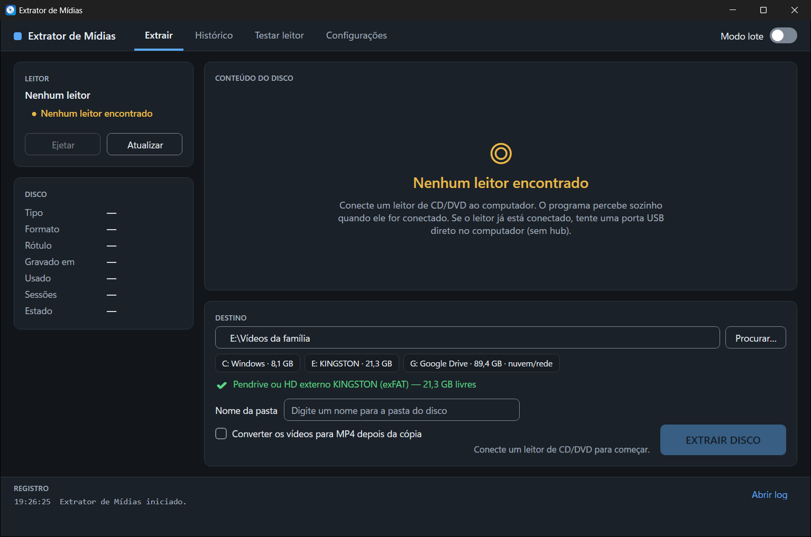 | 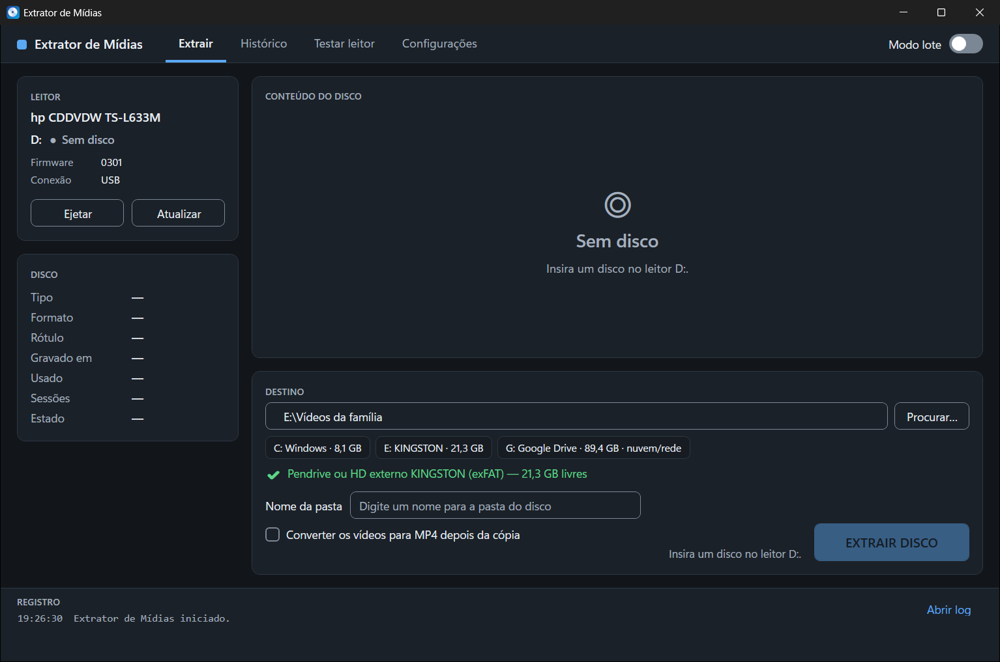 |

**2. Veja o que há no disco.** À direita aparece a lista de pastas e arquivos. Vídeos de DVD aparecem agrupados por "Título" com a duração. Tudo vem marcado; desmarque o que não quiser copiar.

**3. Escolha onde guardar.** Em **DESTINO**, clique em **Procurar…** ou toque em uma das unidades listadas (pendrive, HD…). O programa confere se há espaço e se dá para gravar no local, e avisa o que estiver errado ao lado do botão.

**4. Dê um nome ao disco.** O campo **Nome da pasta** já vem preenchido com o nome gravado no disco (ou com a data). Troque por algo que você reconheça, por exemplo *Formatura 2009*. Se a pasta já existir, o programa cria *Formatura 2009 (2)* — ele nunca mistura nem sobrescreve.

**5. (Opcional) Converter para MP4.** Abaixo do nome há a caixa **Converter os vídeos para MP4 depois da cópia** (desligada por padrão; só aparece disponível se a pasta `tools` estiver ao lado do programa). Os originais ficam intactos e os MP4 vão para uma subpasta `MP4` dentro da pasta do disco. A conversão lê a **cópia** já feita (não o disco, que é ejetado antes), pode ser cancelada e, se falhar, não altera os arquivos copiados. Em DVDs, cada título vira um MP4 (sem os menus). A mesma opção também existe em **Configurações → Conversão** (para deixá-la ligada sempre).

Enquanto converte, a tela mostra um cartão **Convertendo para MP4** com o vídeo atual, o tempo restante e o botão **Cancelar conversão** (cancelar não mexe nos arquivos já copiados). No fim, o resumo diz quantos vídeos foram convertidos e com qual codificador, e avisa se algum veio de uma cópia incompleta (o MP4 pode ter "saltos"):

| Convertendo | Conversão concluída |
|---|---|
| 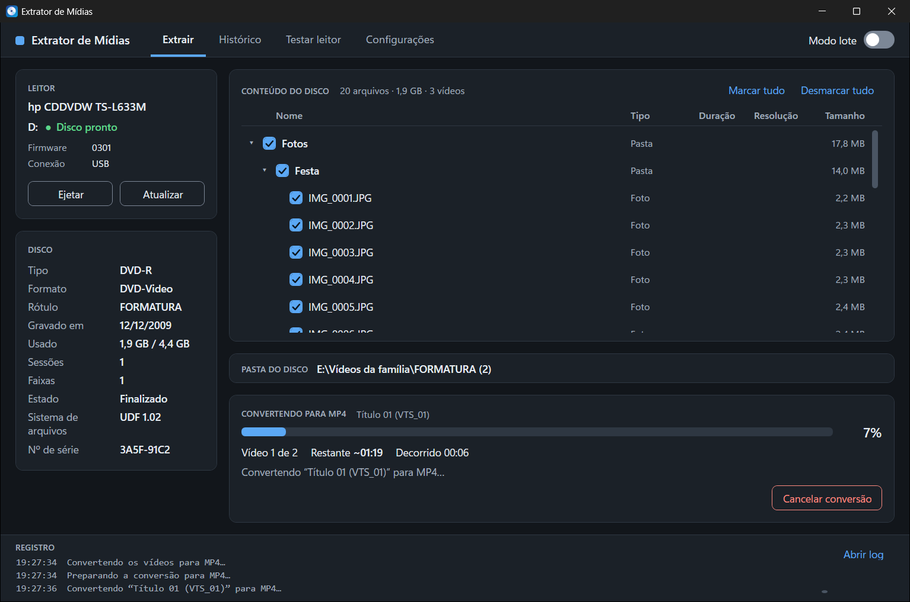 | 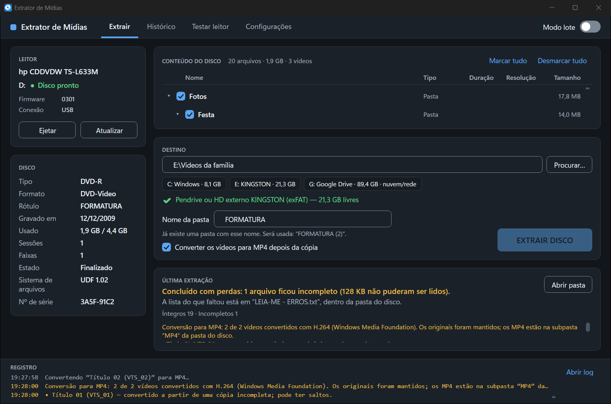 |

<sub>O programa usa o melhor codificador H.264 que o FFmpeg incluído oferecer (`libx264`, se existir; no pacote LGPL, o do próprio Windows ou o OpenH264) e, na falta de todos, MPEG-4 parte 2. Detalhes em [docs/DESVIOS.md](docs/DESVIOS.md).</sub>

**6. Clique em EXTRAIR DISCO.** Acompanhe o progresso. Você pode continuar usando o computador, mas **não feche o programa, não tire o disco e não puxe o cabo do leitor**. Durante a cópia há os botões **Pausar**, **Pular arquivo**, **Insistir mais** (dá mais 10 minutos para tentar recuperar trechos com erro) e **Cancelar**.

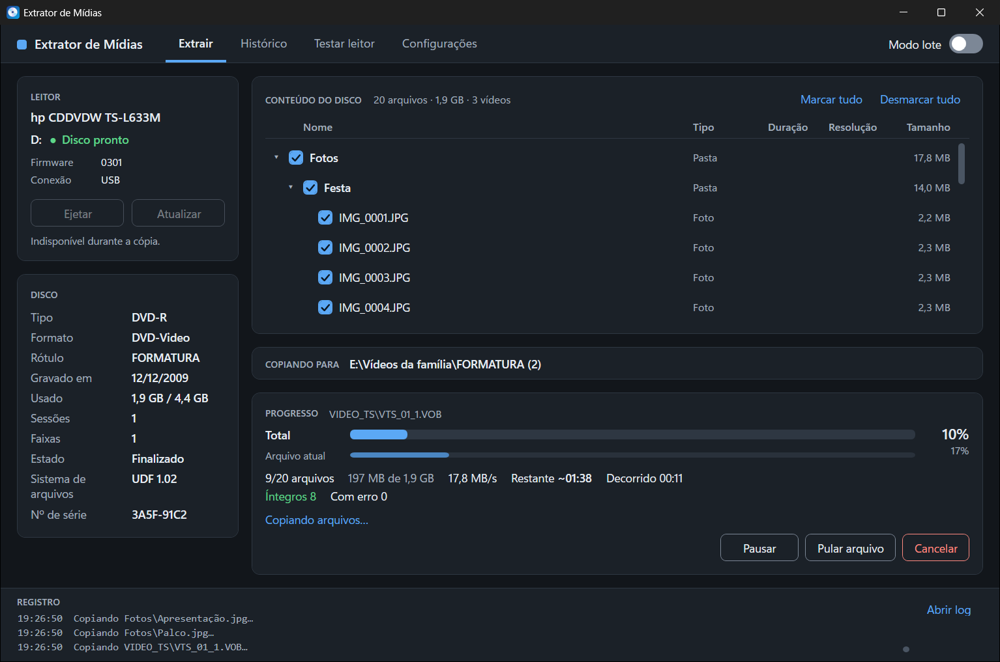

**7. Veja o resumo.** Ao terminar o programa toca um aviso, mostra o resultado e (se estiver configurado) ejeta o disco. Clique em **Abrir pasta** para ver seus vídeos.

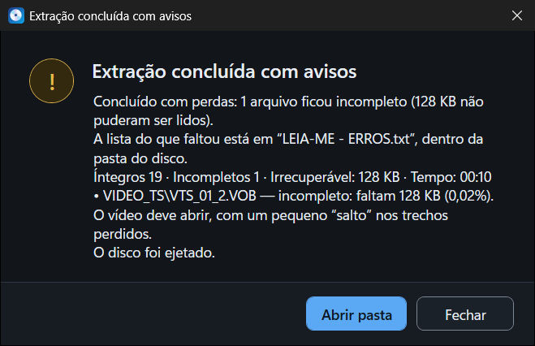

Depois de fechar o resumo, o cartão **Última extração** continua na tela com o que faltou:

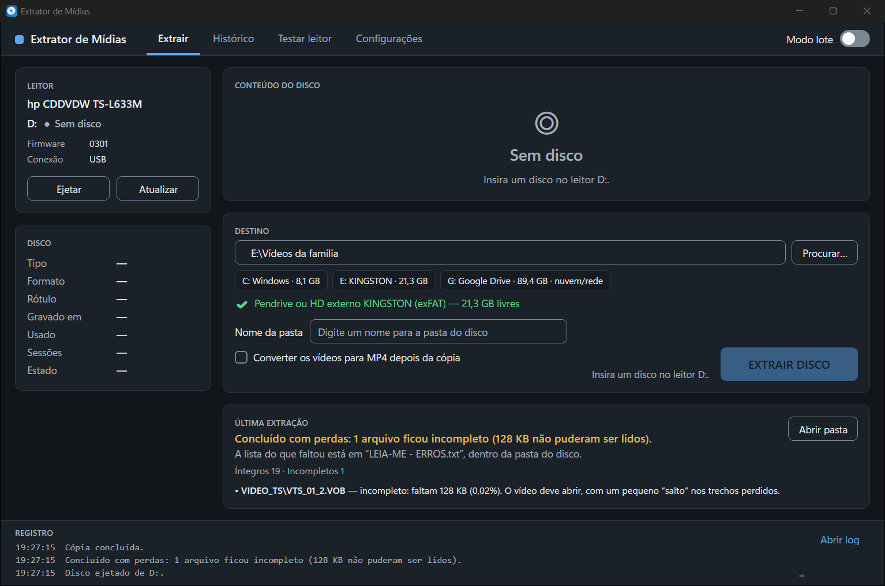

### O que significam os resultados

| Resultado | O que quer dizer |
|---|---|
| **Íntegro** | Copiado e conferido: o arquivo é idêntico ao do disco. |
| **Recuperado** | Houve erro de leitura no meio do caminho, mas o programa conseguiu ler tudo ao tentar de novo. O arquivo está completo e conferido. |
| **Parcial** | Alguns trechos do disco não puderam ser lidos. O vídeo abre, mas pode ter um "pulo" ou uma falha de imagem naquele ponto. A lista exata do que faltou está no arquivo **`LEIA-ME - ERROS.txt`**, dentro da pasta do disco. |
| **Falhou** | Nada do arquivo pôde ser lido (ele não é criado). Veja as dicas abaixo e tente de novo. |
| **Ignorado** | Você pediu para pular o arquivo. |
| **Falha no destino** | O disco foi lido, mas o local de destino (pendrive ou HD) não gravou corretamente. Troque de pendrive/HD. |

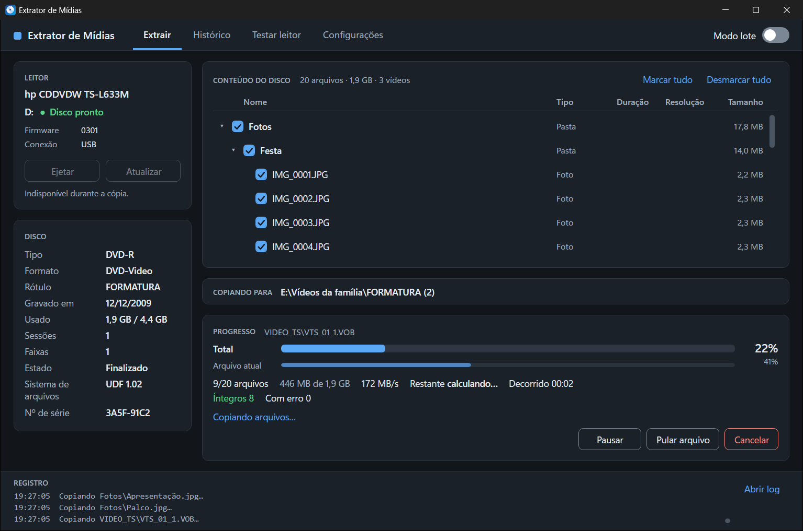

### Mais de um disco: Modo lote

Ligue a chave **Modo lote** (canto superior direito). O ciclo passa a ser: coloque um disco → digite só o nome e aperte Enter → o programa copia e ejeta → "Insira o próximo disco". Se houver qualquer problema (pouco espaço, disco repetido, disco protegido) ele **para e pergunta**, nunca decide sozinho. Ao sair do modo lote aparece o resumo da sessão.

| Modo lote | Pergunta do nome |
|---|---|
| 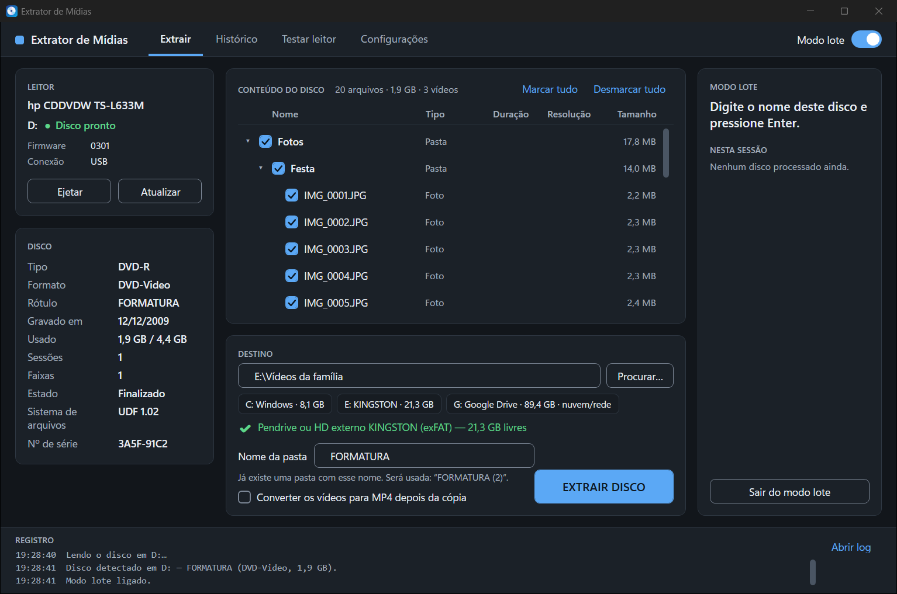 | 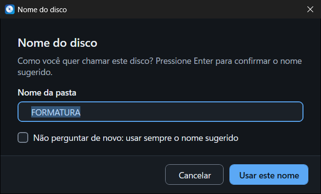 |

### Histórico, disco repetido e retomada

* **Histórico:** lista de todos os discos já extraídos, com busca, botão **Abrir pasta** e **Exportar CSV…**.
* **Disco repetido:** se você colocar um disco que já foi extraído, o programa avisa quando foi e para onde, e deixa você abrir a pasta, extrair de novo ou ejetar.
* **Retomar:** se o programa fechar ou a energia cair no meio de uma cópia, ao recolocar o mesmo disco com o mesmo destino ele oferece **continuar de onde parou**. Os arquivos já concluídos não são copiados outra vez.

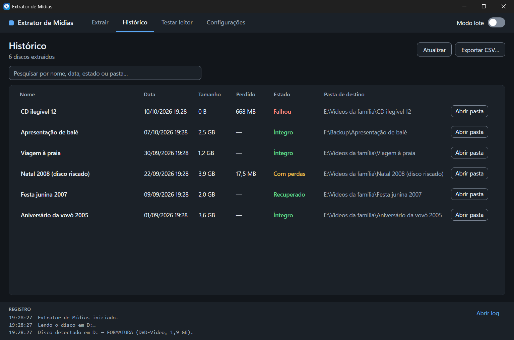

### Testar leitor

Na aba **Testar leitor** o programa verifica se o leitor responde, se reconhece o disco e se consegue ler, e explica em português o que fazer em cada problema. O botão **Copiar relatório** copia o resultado como texto (útil para pedir ajuda). A opção "Teste completo da superfície" lê o disco inteiro e mostra quantos blocos estão ruins — demora vários minutos. A opção **Testar também a bandeja** vem desligada: ligada, o teste abre a bandeja e **ejeta o disco** que estiver no leitor (por isso só roda se você pedir).

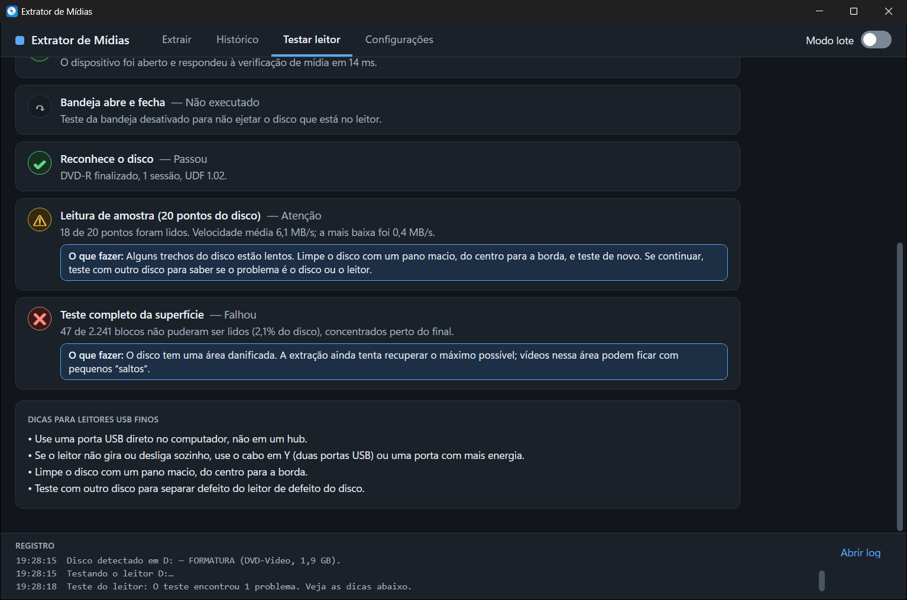

### Dicas para discos riscados e leitores USB finos

* **Disco riscado ou sujo:** limpe com um pano macio e seco, **do centro para a borda** (nunca em círculos). Tente de novo. Deixe ligada, em *Configurações*, a opção **Reduzir a velocidade do leitor quando houver erros** — leitores lentos leem melhor setores difíceis. Se ainda assim ficou *Parcial*, tente outro leitor: a diferença entre aparelhos é grande.
* **Muito degradado?** O programa trabalha dentro de um limite de tempo por disco (20 minutos para a segunda tentativa). Use **Insistir mais** durante a cópia se quiser dar mais tempo.
* **Leitor USB fino (slim):** ligue **direto numa porta USB do computador**, nunca em hub. Se ele não gira, faz barulho de partida repetida ou fica "sumindo e voltando", falta energia: use um **cabo em Y (duas pontas USB)** ou uma porta traseira do computador. O programa avisa quando percebe 3 desconexões em 2 minutos.
* **Leitor não reconhece o disco** (diz "Sem disco" com disco dentro): veja o guia em [docs/TESTE-MANUAL.md](docs/TESTE-MANUAL.md#disco-não-reconhecido--solução-de-problemas).
* **Pendrive FAT32:** não guarda arquivos de 4 GB ou mais (alguns DVDs têm). O programa avisa antes de começar; use um pendrive formatado em **exFAT** ou outro destino.
* **Pendrive/HD defeituoso:** se aparecer *Falha no destino*, o problema é do local de gravação, não do disco.
* **Google Drive / pasta de rede como destino:** funciona, mas a cópia passa pelo cache no `C:` e pode falhar se o `C:` estiver cheio. Prefira um pendrive ou HD.

### Configurações

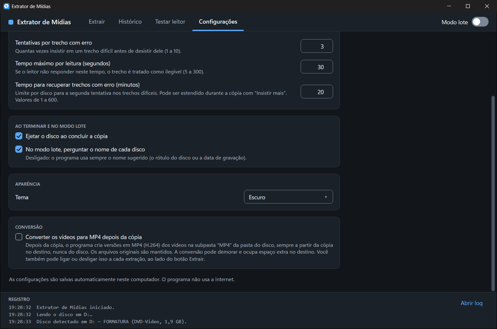

Verificação depois da cópia (ligada por padrão; desligar pede confirmação), reduzir velocidade em erro, tentativas por trecho, tempo máximo por leitura, tempo para recuperar trechos com erro, ejetar ao concluir, perguntar o nome no modo lote, tema (claro, escuro ou seguir o Windows) e conversão opcional para MP4 (desligada por padrão; precisa da pasta `tools`; a caixa na tela principal vale só para a extração seguinte).

### Onde ficam os arquivos do programa

| O quê | Onde |
|---|---|
| Configurações | `%LOCALAPPDATA%\MediaRescue\settings.json` |
| Histórico de discos | `%LOCALAPPDATA%\MediaRescue\catalog.json` (e uma cópia de segurança `.bak`) |
| Registros (logs) | `%LOCALAPPDATA%\MediaRescue\logs\` — o botão **Abrir log** (rodapé) abre o registro mais recente. Guarda até 10 arquivos de 5 MB, sem o conteúdo dos vídeos. |
| Em cada pasta de disco copiado | `mediarescue-manifest.json` (lista de arquivos, tamanhos, SHA-256, resultado), `LEIA-ME - ERROS.txt` (só se faltou algo) e um arquivo oculto `.mediarescue-job.json` usado para retomar |

### Privacidade

O programa **não faz nenhuma conexão de rede**: sem telemetria, sem atualização automática, sem envio de nada. (O código-fonte não contém `HttpClient`, `WebRequest`, sockets ou equivalentes.) O `ffprobe`/`ffmpeg` da pasta `tools` roda localmente, só sobre as cópias e os arquivos do disco. Os registros guardam caminhos de arquivos, nunca o conteúdo deles.

### O que o programa **não** faz

* **Discos comerciais protegidos contra cópia** (filmes de locadora/loja): são recusados com uma mensagem. O programa não tem nem baixa nenhum código para quebrar proteção.
* **CD de áudio** (música): informa que não é suportado nesta versão. Em CDs de modo misto, copia só a parte de dados.
* **Blu-ray**: não suportado.
* **Discos gravados mas não finalizados** (sessão aberta): o programa explica o que fazer (finalizar no aparelho onde foi gravado); não tenta cópia "bruta".
* Não grava discos, não envia para a nuvem e não edita vídeo.
* **Limitações conhecidas** (veja [docs/DESVIOS.md](docs/DESVIOS.md)): não há miniaturas de vídeo; o mapa do teste de superfície é mostrado em texto; a extração em leitor físico real ainda não foi exercitada nesta versão (só com discos simulados e ISOs montadas) — o roteiro de teste está em [docs/TESTE-MANUAL.md](docs/TESTE-MANUAL.md).

---

## Para quem vai desenvolver

### Estrutura

```
MediaRescue.sln
src/
  MediaRescue.Core/       domínio sem dependência de Windows: motor de cópia tolerante a erros, nomes,
                          catálogo, validação de destino, classificação de discos (só fala com o
                          hardware por interfaces: IOpticalDriveService, IDiscReader, IDestinationFileSystem, IClock...)
  MediaRescue.Windows/    P/Invoke (CreateFile/DeviceIoControl/ReadFile overlapped), IMAPI2, WMI,
                          notificações de dispositivo, ffprobe
  MediaRescue.App/        WPF (.NET 8), MVVM com CommunityToolkit.Mvvm
tests/
  MediaRescue.Core.Tests/         unitários com fakes e injeção de falhas
  MediaRescue.App.Tests/          testes de ViewModel (sem janela)
  MediaRescue.Integration.Tests/  ISOs montadas (Mount-DiskImage), sistema de arquivos real, ffprobe
build/   fetch-tools.ps1  make-test-media.ps1  publish.ps1  take-screenshots.ps1  VERSION
docs/    TESTE-MANUAL.md  RASTREABILIDADE.md  DESVIOS.md  screenshots/
SPEC.md  especificação completa (requisitos RF-xx e casos de borda E-xx)
```

### Requisitos para compilar

* Windows 10/11 x64 e o **.NET 8 SDK** (`dotnet --version` → 8.0.x). Sem admin: `dotnet-install.ps1 -Channel 8.0 -InstallDir "$env:LOCALAPPDATA\dotnet"`.
* PowerShell 5.1 ou 7 para os scripts de `build\`.
* Internet **apenas em tempo de build** (pacotes NuGet e download do FFmpeg). O aplicativo em si nunca acessa a rede.

### Compilar e testar

```powershell
dotnet restore
dotnet build -c Release

dotnet test tests\MediaRescue.Core.Tests        # unitários (sem hardware)
dotnet test tests\MediaRescue.App.Tests         # ViewModels
dotnet test tests\MediaRescue.Integration.Tests # ISOs montadas; ver abaixo
```

Para os testes de integração completos:

```powershell
.\build\fetch-tools.ps1        # baixa ffmpeg/ffprobe LGPL (versão fixada, SHA-256 conferido) para tools\
.\build\make-test-media.ps1    # gera vídeos sintéticos em .testmedia\ (poucos MB)
dotnet test tests\MediaRescue.Integration.Tests
```

Os testes que dependem de `Mount-DiskImage` ou das ferramentas aparecem como **ignorados (skipped) com o motivo** quando o ambiente não permite — nunca como aprovados. A rastreabilidade de cada caso de borda (E-01…E-34) e requisito (RF-01…RF-12) a testes está em [docs/RASTREABILIDADE.md](docs/RASTREABILIDADE.md).

### Gerar o pacote portátil

```powershell
.\build\publish.ps1                 # versão lida de build\VERSION
.\build\publish.ps1 -Version 1.2.0  # ou explícita
```

O script localiza o `dotnet` (PATH ou `%LOCALAPPDATA%\dotnet`), baixa o FFmpeg se faltar, publica com `-c Release -r win-x64 --self-contained true -p:PublishSingleFile=true -p:IncludeNativeLibrariesForSelfExtract=true` (em `.artifacts\publish`), renomeia `MediaRescue.App.exe` para `MediaRescue.exe` e monta `dist\MediaRescue-<versão>-win-x64\` (exe, `tools\`, `LEIA-ME.txt`, `THIRD-PARTY-NOTICES.md`, `LICENSE`) mais o `.zip` e um `.sha256`.

### Lançar uma versão (GitHub)

1. Atualize `build\VERSION` e o `CHANGELOG.md`.
2. Crie e envie uma tag: `git tag v1.0.0 && git push origin v1.0.0`.
3. O workflow `.github/workflows/release.yml` compila, roda os testes unitários (obrigatórios) e de integração (informativos), publica e cria a *Release* com o `.zip` e o `.sha256`. O `ci.yml` roda build + testes unitários em todo push/PR para `main`.

### Linha de comando de demonstração

O executável aceita opções para exibir o app **sem tocar em hardware** (dados simulados). Foram usadas para gerar as capturas de tela de `docs\screenshots` (`build\take-screenshots.ps1`).

| Opção | Efeito |
|---|---|
| `--demo` | Usa leitor e disco simulados. |
| `--demo-state=<estado>` | Abre já em um estado: `nodrive`, `nodisc`, `ready`, `copying`, `partial`, `converting` (copia e depois mostra a conversão para MP4 em andamento), `converted` (conversão concluída), `diagnostics`, `history`, `settings`, `batch`. |
| `--theme=light\|dark\|system` | Tema (só no modo demonstração). |
| `--demo-files=N` | Disco simulado com N arquivos (testa a lista com muitos itens). |
| `--demo-duplicate` | Simula um disco já extraído. |
| `--smoke` | Abre a janela, espera carregar e sai com código 0 (diferente de 0 em caso de erro). |

Variável de ambiente `MEDIARESCUE_DEMO_SIZE=1100x700` define o tamanho da janela em modo demonstração.

`build\take-screenshots.ps1` gera todas as telas (tema escuro e claro) a partir do `.exe` publicado; opções: `-Only ready,history` (só algumas telas), `-Themes dark` (um tema), `-Size 1100x700` (tamanho da janela) e `-FileTag -min` (sufixo no nome dos arquivos). Sem `-Only`, gera `docs\screenshots\<tela>.png` e `<tela>-light.png`.

### Licença

MIT — veja [LICENSE](LICENSE). Componentes de terceiros (FFmpeg LGPL e bibliotecas .NET) em [THIRD-PARTY-NOTICES.md](THIRD-PARTY-NOTICES.md).
